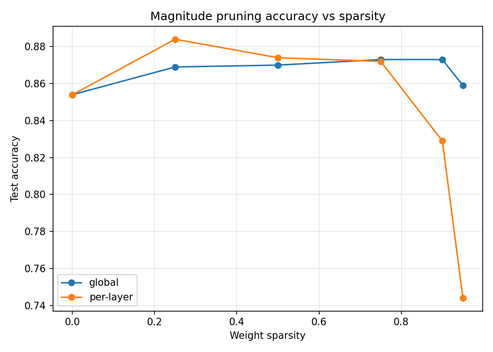
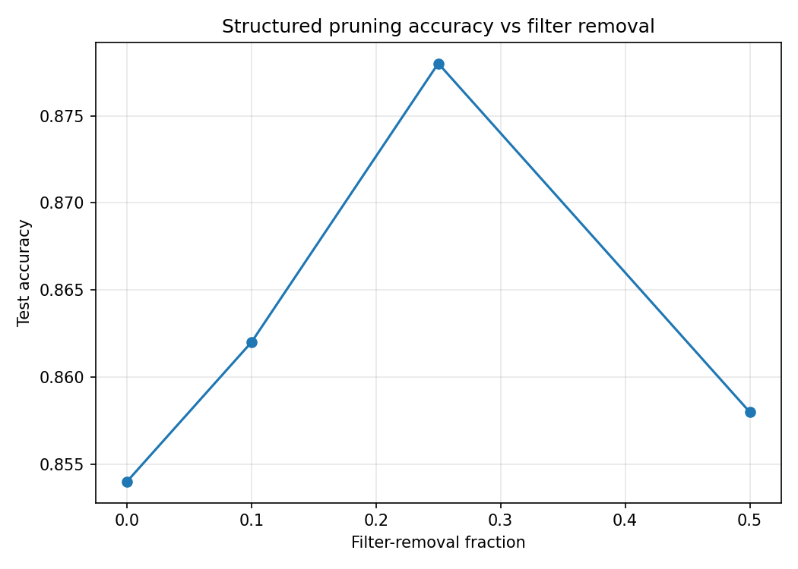

# Lab 07 — Efficiency: pruning, sparsity, and distillation

## Setup and dataset decision

All experiments use Fashion-MNIST with `ToTensor()` and
`Normalize((0.2860,), (0.3530,))`. The official training set was split into
55,000/5,000 train/validation examples with seed 42, as in Lab 03. For a
reasonable CPU-only runtime, this lab uses the first deterministic **4,000
training, 1,000 validation, and 1,000 test examples** from those splits. This
same subset and seed are used by every experiment; the validation split is
reserved but the reported accuracies are test-subset accuracies. Training uses
batch size 128, Adam with learning rate 0.001, and one CPU thread.

## Task 1 — Oversized baseline CNN

The baseline is Conv(1,32)-Conv(32,64)-pool-Conv(64,128)-Conv(128,128)-pool,
followed by Linear(128×7×7,128)-Linear(128,10). It has **1,044,490
parameters**, near the requested one-million target. It was trained for five
epochs. The checkpoint is [baseline.pt](results/baseline.pt), and the measured
metrics are in [baseline_metrics.csv](results/baseline_metrics.csv).

| Metric | Measured value |
|---|---:|
| Test accuracy | 0.85400000 |
| Parameter count | 1,044,490 |
| State-dict size | 4,084.501953 KB |
| Median batch-1 latency (100 runs) | 3.222600 ms |

## Task 2 — Magnitude and structured pruning

Every nonzero pruning point was fine-tuned for exactly three epochs with its
`torch.nn.utils.prune` mask fixed. Global pruning uses one L1 threshold over all
Conv2d/Linear weights; per-layer pruning applies the same ratio independently
to each such tensor. Structured pruning applies `ln_structured(n=2, dim=0)` to
each convolution. Full results, including nonzero weight counts, are in
[pruning_metrics.csv](results/pruning_metrics.csv).

| Method | 0 | 0.10 | 0.25 | 0.50 | 0.75 | 0.90 | 0.95 |
|---|---:|---:|---:|---:|---:|---:|---:|
| Global accuracy | 0.854 | — | 0.869 | 0.870 | 0.873 | 0.873 | 0.859 |
| Per-layer accuracy | 0.854 | — | 0.884 | 0.874 | 0.872 | 0.829 | 0.744 |
| Structured accuracy | 0.854 | 0.862 | 0.878 | 0.858 | — | — | — |

Global pruning retained 104,400 nonzero weights at 90% sparsity and still
measured 0.873 accuracy after fine-tuning. Per-layer pruning was strongest at
25% (0.884) but degraded substantially at 90–95%. The structured 25% filter
removal result reached 0.878 accuracy; its 50% result was 0.858.

## Task 3 — Latency and dense-versus-sparse storage

The efficiency script measures the baseline, the fine-tuned 90% global model,
and the fine-tuned 50% structured model. The latter two are saved as
[global_0.90.pt](results/global_0.90.pt) and
[structured_0.50.pt](results/structured_0.50.pt). Results are in
[efficiency_metrics.csv](results/efficiency_metrics.csv).

| Model | Latency (ms) | Dense state-dict (KB) | Sparse COO state-dict (KB) |
|---|---:|---:|---:|
| Baseline | 2.843550 | 4,084.501953 | 24,146.974609 |
| Global 0.90 | 2.858000 | 4,084.548828 | 3,295.726562 |
| Structured 0.50 | 2.632050 | 4,084.673828 | 19,930.125000 |

The structured checkpoint is masked but retains the original tensor shapes; no
filters/channels were physically rebuilt. Therefore its dense serialized size
and dense CPU compute remain essentially unchanged (the small latency difference
is measurement variation), rather than constituting a guaranteed deployment
speedup.

Unstructured sparsity—zeroing individual weights—rarely speeds up dense CPU
kernels because standard BLAS/cuDNN/MKL-style dense matrix-multiplication and
convolution kernels have no skip-zero optimization: they still iterate over and
multiply all weight positions, including zeroes. Masking alone does not reduce the actual FLOPs executed.
Genuine speedups require physically smaller dense tensors (structured pruning)
or specialized sparse-matrix kernels/libraries, such as CSR sparse BLAS, that
plain PyTorch eager or standard dense convolution paths do not use by default.
The COO representation is useful for showing storage tradeoffs, but its indices
can outweigh values at low sparsity, as the baseline and structured rows show.

## Task 4 — Knowledge distillation

The frozen five-epoch baseline is the teacher. The student uses
Conv(1,16)-pool-Conv(16,32)-pool-Linear(32×7×7,64)-Linear(64,10), with
**105,866 parameters**. Plain and distilled students use identical architecture,
data order/seed, optimizer, learning rate, and five-epoch schedule. Distillation
uses alpha=0.5, temperature T=4, and the required T²-scaled batch-mean KL loss;
the teacher is in eval mode and its forward pass uses no gradients.

| Model | Accuracy | Size (KB) | Latency (ms) |
|---|---:|---:|---:|
| Teacher/baseline | 0.85400000 | 4,084.501953 | 3.222600 |
| Plain student | 0.83700000 | 416.945312 | 0.319050 |
| Distilled student | 0.81700000 | 416.992188 | 0.320100 |

The complete table is [distillation_metrics.csv](results/distillation_metrics.csv),
with checkpoints [student_plain.pt](results/student_plain.pt) and
[student_distilled.pt](results/student_distilled.pt). On this small subset and
short schedule, distillation did not beat the plain student's accuracy, while
both students reduced serialized size and latency substantially versus the
teacher.

## Task 5 — Efficiency-pillar summary and conclusion

| Chapter 9 pillar | This lab's technique and measured result |
|---|---|
| **Data** | A deterministic 4,000/1,000/1,000 subset kept repeated pruning and distillation CPU experiments feasible; all comparisons use the same seed and split. |
| **Model** | Magnitude pruning retained fewer nonzero weights (104,400 at global 90%); the 105,866-parameter students reduced state-dict size from 4,084.50 KB to about 416.95 KB. |
| **Compute** | Global 90% masking was 2.858000 ms versus the 2.843550 ms efficiency rerun baseline, showing no meaningful dense-kernel speedup; the compact students were about 0.32 ms. Fixed-mask pruning cost 3 fine-tuning epochs per point. |
| **Energy** | Lower student inference latency and storage are practical proxies for lower deployment energy and memory traffic. Mask-only unstructured/structured checkpoints do not guarantee energy savings without sparse kernels or physical compaction. |

The results show a useful accuracy–sparsity tradeoff rather than a monotonic
one: global pruning stayed at 0.873 through 90% sparsity after fine-tuning,
whereas per-layer pruning fell to 0.744 at 95%. Structured filter masking was
competitive at 25%, but without rebuilding tensors it did not shrink dense
storage or guarantee latency gains. Distillation produced a very small,
fast student, but under this subset and schedule the plain student (0.837) beat
the distilled student (0.817); thus the main reliable deployment win here is
student size/latency, while accuracy benefits from distillation remain
schedule- and data-dependent.

## Reproducible source files

- [baseline.py](src/baseline.py)
- [pruning.py](src/pruning.py)
- [measure_efficiency.py](src/measure_efficiency.py)
- [distillation.py](src/distillation.py)
